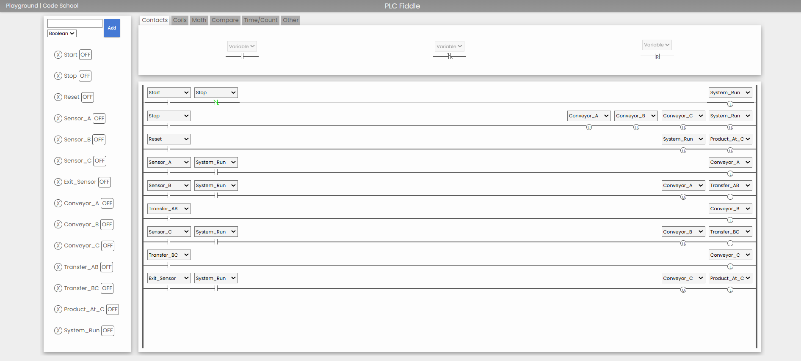

# Multi-Conveyor Automation System

A PLC-based conveyor automation simulation demonstrating sequential material handling, sensor-based control, and inter-conveyor transfer logic using ladder diagrams.

## Project Overview

This project models an automated material-handling process involving three conveyor stages. Boolean sensors and control variables coordinate the movement of products through the simulated system.

**Platform:** PLC Fiddle  
**Control method:** Ladder logic  
**Project type:** Simulation  
**Focus areas:** PLC programming, industrial automation, sequential control

## System Architecture

The system consists of three conveyor stages:

- **Conveyor A:** Initial product-handling stage.
- **Conveyor B:** Intermediate transfer stage.
- **Conveyor C:** Final transfer stage leading to the exit.

The control logic uses Start, Stop, and Reset inputs alongside product sensors to coordinate conveyor operation.

## Control Sequence

1. Start enables the system when the Stop condition is inactive.
2. Sensor A and the system run state control Conveyor A.
3. Sensor B initiates the transfer condition from A toward B.
4. Sensor C initiates the transfer condition from B toward C.
5. Exit sensor detection stops Conveyor C and clears the associated product-state variable.

The system was tested in PLC Fiddle, and its simulated operation behaved as intended.

## Simulation

**[Run the Multi-Conveyor Automation System on PLC Fiddle](https://tinyurl.com/drhtc4bz)**

## Simulation Screenshot

> If the image doesn't display, check the actual filename inside the `images/` folder and update the path above to match it exactly.

## Project Documentation

- [Ladder Logic Documentation](ladder-logic.md)
- [Input/Output Mapping](io-mapping.md)
- [System Sequence Diagram](system-sequence.md)
- [Test and Validation Report](test-and-validation.md)

## Engineering Concepts Demonstrated

- PLC ladder logic
- Boolean logic and control conditions
- Sensor-based automation
- Sequential conveyor control
- Inter-conveyor transfer conditions
- Start, stop, and reset logic
- Simulation-based testing

## Future Improvements

- Add timed transfer operations.
- Implement product counting and throughput monitoring.
- Add jam detection and fault alarms.
- Develop an explicit fault-recovery sequence.
- Map logical variables to physical PLC I/O addresses for a hardware implementation.

## Limitations

This is a simulation-based project. It does not demonstrate a physical conveyor installation or safety-certified industrial control system.

## Author

**Soham Bharat Punjal**  
B.Tech Electrical and Electronics Engineering, NIT Warangal

Interests: Robotics, Embedded Systems, and Industrial Automation.
