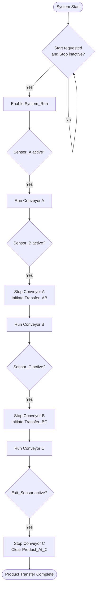

# System Sequence Diagram

## Overview

This diagram represents the intended control sequence of the three-stage conveyor system implemented in PLC Fiddle.

## Control Flow

## Sequence Explanation

1. **System activation:** Start and Stop conditions determine whether the system can run.
2. **Stage A:** Sensor A and `System_Run` control Conveyor A.
3. **Transfer A to B:** Sensor B initiates the transition from Conveyor A to Conveyor B.
4. **Transfer B to C:** Sensor C initiates the transition from Conveyor B to Conveyor C.
5. **Exit stage:** Exit sensor detection stops Conveyor C and clears the associated product-state variable.

## Notes

- This is a conceptual representation of the implemented ladder logic, not a timing diagram.
- The diagram omits detailed reset behavior and individual PLC scan cycles for clarity.
- Refer to [Ladder Logic Documentation](ladder-logic.md) for the rung-level explanation.
- Refer to [Input/Output Mapping](io-mapping.md) for the variable descriptions.
